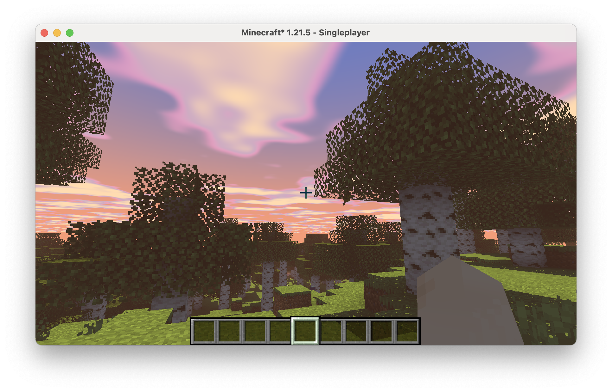
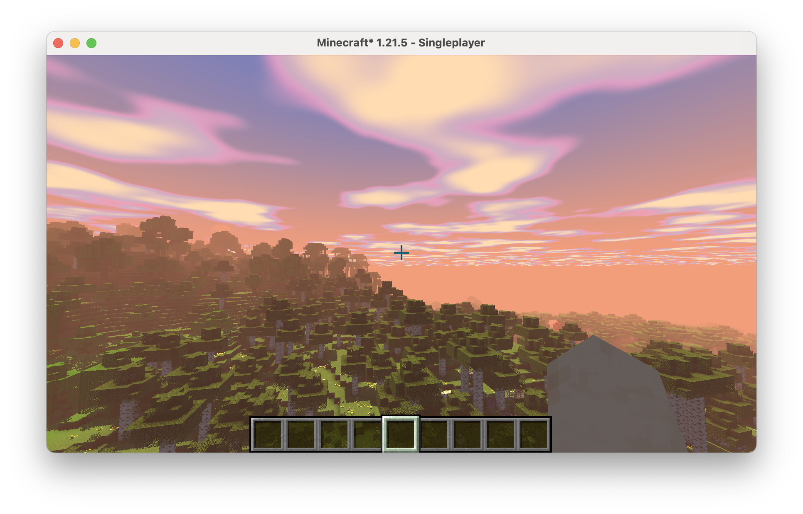
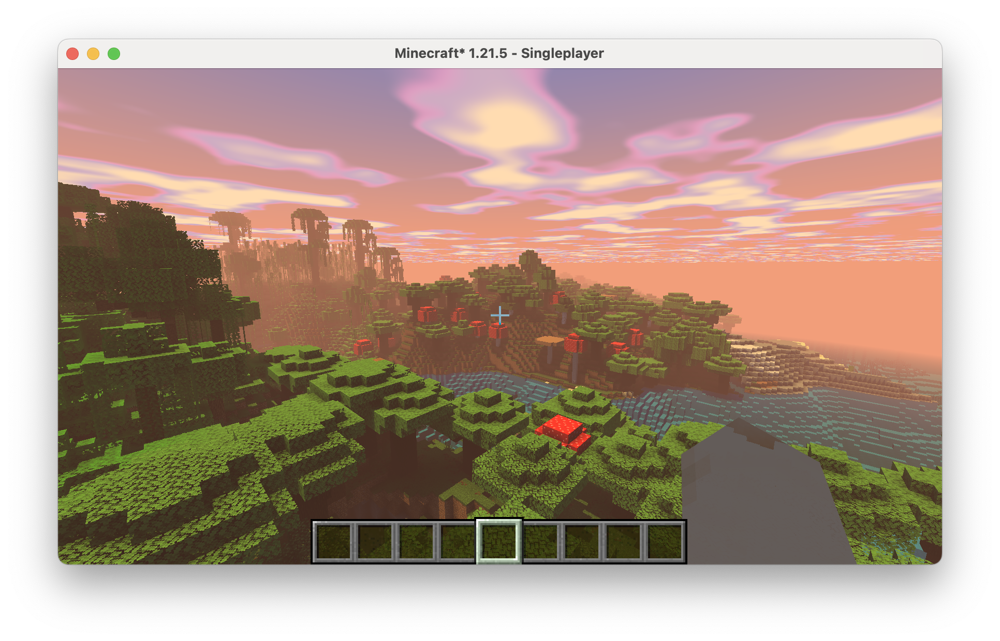

# Minecraft Shader

A shader I made for Minecraft 1.21.5 and Iris. This is my first time coding with shaders, so it is pretty simple. I mostly played around with the colors and lighting, as you can see with the skymap.

## Requirements

- Minecraft 1.21.5
- Iris Shaders
- OpenGL 3.3-capable graphics support

## Installation

1. Download or clone this repository.
2. Copy the `shaders` folder into:
   - `.minecraft/shaderpacks/`
3. Open Minecraft.
4. Go to **Options → Video Settings → Shader Packs**.
5. Select this shader pack.

## Screenshots

here are some screenshots of the shader in action!



You can see the clouds in the sky 
It gives the illusion of a cool sunset

## Project Structure

```text
shaders/  # GLSL shader source files